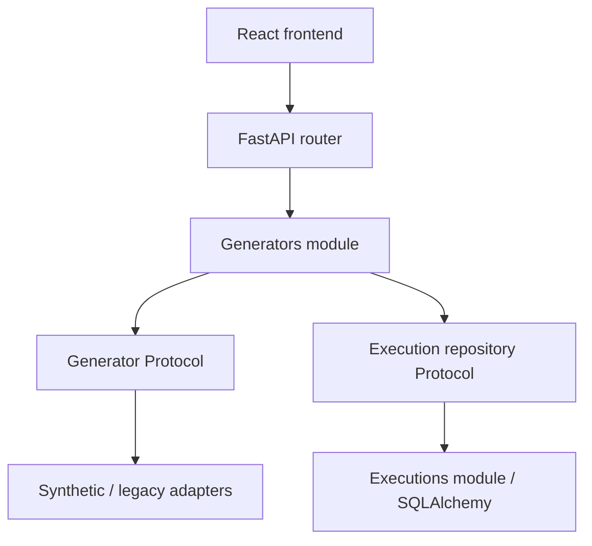

# Mass Platform — Python-first modular platform

Reference implementation for consolidating test-data generators into a web platform.
The backend is a **feature-first modular monolith**, using `Protocol` at replaceable
integration boundaries. The frontend is a separate React + TypeScript application.

## Stack

- Python 3.12+, FastAPI, Pydantic Settings v2
- SQLAlchemy 2 for persistence (SQLite in local mode; configurable DB URL)
- uv for development, Ruff for linting, pytest/httpx for tests
- OpenAPI via FastAPI at `/docs`
- React 19 + TypeScript + Vite for the web interface

## Local setup (two terminals)

```bash
cp .env.example .env
uv sync
uv run uvicorn mass_platform.main:app --reload
```

Then run the frontend:

```bash
cd frontend
cp .env.example .env.local
npm install
npm run dev
```

Open `http://localhost:5173`. The Vite development proxy sends `/api` calls
to the backend on port 8000 and adds the local development API key server-side.
Never expose long-lived API keys in browser code, bundles or `VITE_*` environment variables.
The production frontend will require an identity-aware gateway/BFF or equivalent
authorization integration.

Try:

```bash
curl -H "X-API-Key: local-development-key-change-me" http://127.0.0.1:8000/v1/generators
curl -X POST http://127.0.0.1:8000/v1/generators/synthetic-customer/executions \
  -H "X-API-Key: local-development-key-change-me" -H "Content-Type: application/json" \
  -d '{"parameters":{}}'
curl -H "X-API-Key: local-development-key-change-me" "http://127.0.0.1:8000/v1/credit-card-contracts?processor_code=PROC-VPLUS&brand=visa&contract_status=ativo"
```

Run backend checks with `uv run ruff check .` and `uv run pytest`.
Run frontend checks with `cd frontend && npm run build`.

## Architecture



### Dependency rules

- `modules/credit_card_contracts/`: synthetic issuer credit card contract catalog across card processors, filtering service, `CreditCardContractRepository` protocol, and `/v1/credit-card-contracts` API router (100% synthetic masked PANs, no real PII).
- `modules/generators/`: API router, schemas, service, ports, concrete generators.
- `modules/executions/`: execution model and persistence adapter.
- `auth.py`: shared local API-key security dependency.
- `config.py`: environment configuration.
- `main.py`: minimal application composition and lifecycle.
- `frontend/`: React client (feature modules under `src/features/`) and development-only API proxy.

Add a generator by implementing the `Generator` protocol and registering it in
`create_app()`. Legacy applications may initially be wrapped by adapters and
then migrated one capability at a time.

## Scope and production gates

This is an executable **foundation, not a production-ready deployment**.
Before shared or production use:

1. Replace the development API-key mechanism with corporate OIDC/JWT and RBAC;
   enforce caller ownership on execution retrieval.
2. Replace startup `create_all` with versioned Alembic migrations, managed Postgres
   and integration tests against the real engine.
3. Add asynchronous job workers, queueing, retry policies, idempotency and timeouts
   for long-running generators. The current sync endpoint is for quick operations.
4. Add audit events, structured logging, tracing, metrics, rate limits and payload
   size quotas. Avoid storing secrets or real personal data in generation results.
5. Harden runtime image (pinned dependencies/digest, security scans), configure
   secret management, TLS, least privilege, retention and backups.

The initial generator deliberately returns a random identifier with no personal data.
